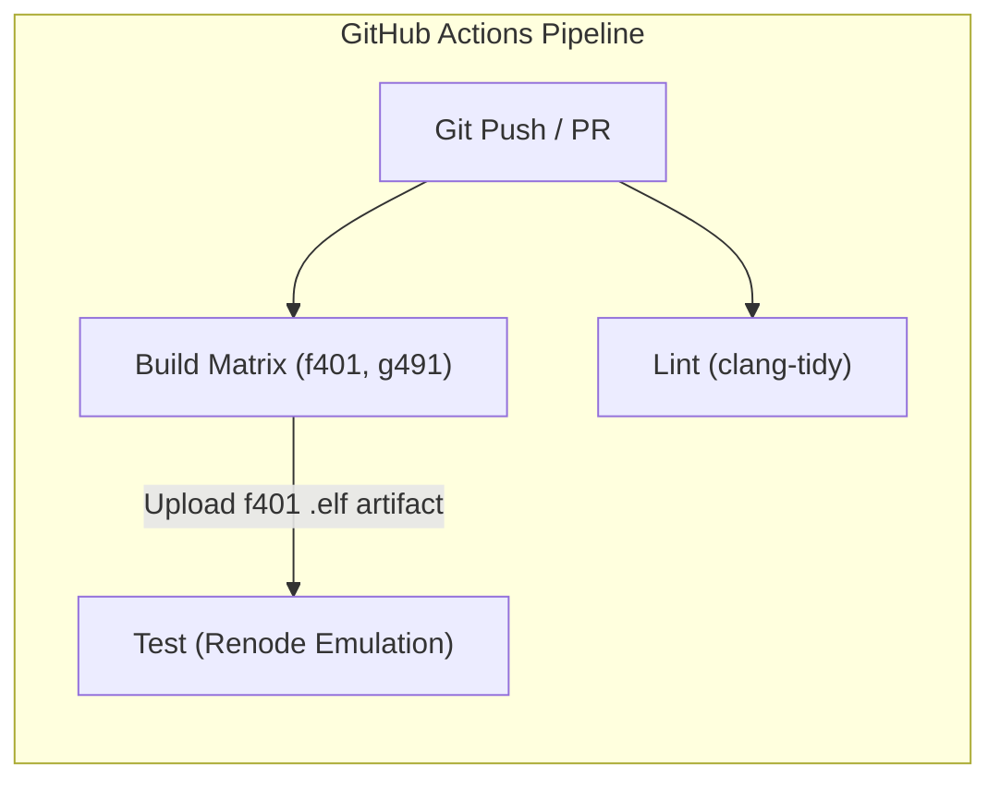

# STM32 + FreeRTOS Template & Emulation Lab

[](https://github.com/zephyrcodesstuff/stm32-rtos-template/actions/workflows/ci.yml)
[](LICENSE)
[](https://www.freertos.org/)
[](https://renode.io/)
[](https://probe.rs/)

A modern, production-grade template and reference lab for embedded C firmware development on STM32 microcontrollers. 

This repository moves away from legacy embedded toolchains, vendor IDE lock-in, committed binary bloat, and monolithic Makefiles.

Instead, it demonstrates a **cloud-ready, reproducible embedded developer experience (DX)** featuring automated dependency fetching, multi-target support, strict static analysis, and automated hardware-in-the-loop emulation testing without physical test benches.

## 🌟 Featurs

- **Zero-Vendored Dependencies (`CMake FetchContent`)**: CMSIS Core, ST HAL drivers, CMSIS-FreeRTOS, and the FreeRTOS Kernel are downloaded and configured dynamically at build time. No bulky git submodules, no checking vendor SDKs into version control.
- **Multi-Board Architecture**: Modular target abstraction supporting both **STM32F401RE** (Cortex-M4F) and **STM32G491RE** (Cortex-M4F) with drop-in support for additional STM32 families.
- **FreeRTOS Concurrency Showcase (UART Calculator Lab)**: An interrupt-driven asynchronous UART binary packet calculator executing operations concurrently alongside a non-blocking FreeRTOS LED heartbeat task.
- **Virtual Hardware Testing (Renode + Robot Framework)**: Automated dynamic testing executed directly against simulated Cortex-M4 hardware and memory, allowing full end-to-end integration tests in CI without physical hardware attached.
- **Strict Static Analysis (`clang-tidy`)**: Enforces mission-critical safety, MISRA/CERT C guidelines, const-correctness, and internal linkage rules with zero-warning tolerance (`--warnings-as-errors='*'`).
- **CI Pipeline**: GitHub Actions jobs for **Build** (multi-target matrix), **Lint** (static analysis), and **Test** (Renode emulation).
- **First-Class Developer Ergonomics**: Powered by **[`just`](https://github.com/casey/just)** for single-word CLI commands, **[`probe-rs`](https://probe.rs/)** for instant SWD flashing and live RTT logging, and full VS Code / `clangd` language server integration.

## 🔬 Application: UART Calculator

The default firmware under [`Src/main.c`](Src/main.c) implements a concurrent FreeRTOS laboratory application:

1. **Non-Blocking Background Task (`TASK_BlinkLED`)**: Continuously toggles the on-board user LED (PA5) every 500 ms via `osDelay()`.
2. **Asynchronous UART Service (`TASK_ReceiveUSART2`)**: Listens on USART2 (115200 baud) for binary calculation packets without stalling the system or starving secondary tasks.

### Packet Protocol

- **Request Packet (12 bytes, packed little-endian)**:
  ```text
  [ int32 opcode ][ int32 operand1 ][ int32 operand2 ]
  ```
  | Opcode | Operation | Example (`op1=15, op2=27`) |
  | :--- | :--- | :--- |
  | `0` (`CALC_OPERAND_ADD`) | Addition | Result: `42` |
  | `1` (`CALC_OPERAND_SUB`) | Subtraction | Result: `-12` |
  | `2` (`CALC_OPERAND_MUL`) | Multiplication | Result: `405` |
  | `3` (`CALC_OPERAND_DIV`) | Division | Result: `0` (div by 0 returns `0xDEADBEEF`) |

- **Response Packet (4 bytes, little-endian)**:
  ```text
  [ int32 result ]
  ```

# STM32 Template

The following is an excerpt from the [original template](https://github.com/zephyrcodesstuff/stm32-rtos-template) this lab uses.

## 🛠️ Prerequisites & Setup

### Recommended Toolchain

- **Compiler**: **ST-Arm-Clang** (automatically provisioned via the [STM32Cube for VS Code](https://marketplace.visualstudio.com/items?itemName=STMicroelectronics.stm32cubeide-vscode-extension-pack) extension or standalone ST bundles).
- **Build System**: **CMake** (>= 3.20) + **Ninja**.
- **Task Runner**: **`just`** ([installation guide](https://github.com/casey/just#installation)).
- **Hardware Flasher**: **`probe-rs`** ([probe.rs installation](https://probe.rs/)).
- **Linter**: **`clang-tidy`** (LLVM suite).
- **Emulator**: **Renode** ([renode.io](https://renode.io/)) + **Robot Framework** (for running automated tests).

### Installation

#### macOS (Homebrew)
```bash
brew install cmake ninja just probe-rs/probe-rs/probe-rs llvm
```

#### Ubuntu / Debian Linux
```bash
sudo apt update
sudo apt install -y cmake ninja-build clang-tidy python3-pip just

# Install probe-rs flasher
curl -L --proto '=https' --tlsv1.2 -sSf https://probe.rs/install.sh | sh

# Configure udev permissions for ST-Link / probe-rs
curl -fsSL https://probe.rs/files/69-probe-rs.rules | sudo tee /etc/udev/rules.d/69-probe-rs.rules
sudo udevadm control --reload-rules && sudo udevadm trigger
```

## 🚀 Quickstart with `just`

The project includes a concise, self-documenting [`justfile`](justfile) covering everyday developer tasks:

```bash
# 1. Build firmware (defaults to STM32F401RE Debug)
just build

# 2. Run static analysis (clang-tidy with user code filtering)
just lint

# 3. Run Renode emulation test suite (STM32F401RE)
just test

# 4. Flash connected board via probe-rs and reset
just flash

# 5. Flash and attach live RTT / SWO monitor
just run

# 6. Check memory footprint (Flash & RAM utilization)
just size
```

Run `just` or `just --list` to view all available recipes.

## 🎯 Target Switching

The build system cleanly supports switching between boards without modifying code:

```bash
# Build STM32F401RE
just target=f401 build
just target=f401 size

# Build STM32G491RE
just target=g491 build
just target=g491 size

# Release builds
just target=f401 build_type=Release build
```

Target aliases (`f401`, `g491`) are automatically resolved to their canonical board configurations in `boards/` via [`scripts/resolve-board.sh`](scripts/resolve-board.sh).

## 🧪 Automated Testing with Renode

Virtual hardware emulation is implemented using **Renode** and **Robot Framework** in [`test/calculator.robot`](test/calculator.robot):

```bash
just test
```

### What the test suite verifies:
1. Instantiates a simulated Cortex-M4 platform (`test/stm32f401re.repl`).
2. Loads the compiled `lab-calculator.elf` binary into simulated flash.
3. Transmits binary packets over virtual `sysbus.usart2`.
4. Tests mathematical correctness across addition, subtraction, multiplication, and division.
5. Inspects virtual MCU memory registers (`sysbus GetSymbolAddress "g_uart2_res"`) to confirm execution state.

> [!NOTE]
> Renode emulation is configured for **STM32F401RE**. Renode upstream currently models the STM32F4 series; the `STM32G4` family does not yet have an upstream platform definition. Running `just target=g491 test` cleanly reports this target boundary.

## 🔄 CI/CD Architecture

The GitHub Actions workflow ([`.github/workflows/ci.yml`](.github/workflows/ci.yml)) executes a three-pillar quality gate:



- **Build Job**: Compiles both boards concurrently in a build matrix with `fail-fast: false`, checks memory footprints, and exports the `f401` `.elf` binary artifact.
- **Lint Job**: Runs static analysis across user source code in parallel.
- **Test Job**: Runs only after `build` succeeds. It downloads the pre-built `.elf` artifact and runs Renode emulation with cached dependencies—**zero compiler re-installation required**.


```text
├── CMakeLists.txt              # Root build script with FetchContent configurations
├── CMakePresets.json           # IDE presets for VS Code (Debug / Release for each board)
├── justfile                    # Ergonomic task runner
├── boards/                     # Modular board support packages
│   ├── STM32F401RE/            # Board linker script, clock, and HAL configuration
│   └── STM32G491RE/
├── cmake/                      # Modular CMake dependency & compiler setup
│   ├── hal.cmake               # Unified family-aware HAL driver fetcher
│   ├── freertos.cmake          # FreeRTOS kernel fetcher
│   ├── freertos-cmsis.cmake    # CMSIS-RTOS2 v2 adapter fetcher
│   ├── flags.cmake             # Cortex-M compiler, linker, and optimization flags
│   └── starm-clang.cmake       # ST-Arm-Clang / LLVM toolchain integration
├── Inc/                        # Application header files
│   ├── calculator.h            # Packet protocol & opcode definitions
│   ├── FreeRTOSConfig.h        # FreeRTOS kernel tuning & SysTick mapping
│   └── stm32_hal.h             # Universal HAL redirector
├── Src/                        # Application source files
│   ├── main.c                  # FreeRTOS blinker & USART2 calculator tasks
│   ├── syscall.c               # POSIX system stubs
│   └── sysmem.c                # Dynamic memory allocator stubs
└── test/                       # Virtual hardware emulation suite
    ├── calculator.robot        # Robot Framework test cases
    └── stm32f401re.repl        # Renode peripheral & platform layout
```

## ➕ Adding a New Board

To add another STM32 board (e.g. `STM32L476RG`):

1. Create `boards/STM32L476RG/`:
   - `board.cmake` (defines `MCU_MODEL`, `MCU_FAMILY`, `CPU_FLAGS`, `PROBE_CHIP`).
   - `stm32l4xx_hal_conf.h` (peripheral enable flags).
   - `flash.ld` (memory region layout for Flash & RAM).
2. Build immediately without touching any build scripts:
   ```bash
   just target=STM32L476RG build
   ```

## 📜 License

Licensed under either of [Apache License, Version 2.0](LICENSE) or [MIT License](LICENSE) at your option.
